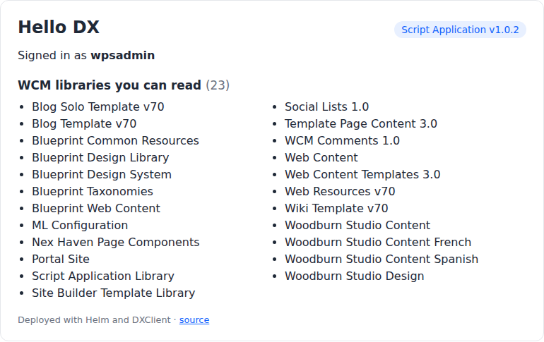

# Script Applications for HCL DX, deployed with Helm

[Español](README.es.md)

**Deploy an HCL DX Script Application with `helm install`, like the rest of your Kubernetes stack.**

A Script Application is HTML, JavaScript and CSS stored in DX's Web Content Manager (WCM): it is the
way to build custom applications on **HCL DX Compose**, where custom Java portlets need the separate
*Java Transition Module*. HCL deploys them with the DXClient command line tool. This repository
wraps that step in a Helm chart, so a Script Application gets a version, a chart and a
`helm upgrade`, and can travel with the backend services it talks to.

It contains:

| Folder | What it is |
|---|---|
| [app/](app) | **Hello DX**, a small React Script Application (Vite, TypeScript), made from HCL's `create-dx-script-app` template. It shows who the user is and which WCM libraries they can read, calling DX **as that user** |
| [app/Dockerfile](app/Dockerfile) | The **bundle image**: a tiny image that only carries the built app |
| [chart/hcl-dx-scriptapp](chart/hcl-dx-scriptapp) | The **Helm chart**: a Job that pushes the app to DX with DXClient |



The same page shows 23 libraries to `wpsadmin` and 21 to a regular LDAP user of the labs: the app
has no permission logic of its own, DX applies the signed-in user's.

It is an example, not a product, and it is not HCL software. Tested on HCL DX Compose CF239
(DXClient `v95_CF239_20261103-1404`).

## How it works

```
helm upgrade --install hello-dx oci://ghcr.io/europesip/charts/hcl-dx-scriptapp ...
   │
   └─ Job (Helm hook, after every install and upgrade)
        ├─ initContainer  bundle image ─► copies the built app (index.html, assets/) to a volume
        └─ container      HCL DXClient ─► waits for DX, then
                                          dxclient deploy-scriptapplication push
                                          ─► WCM: Script Application Library/Script Applications/<name>
```

- **First install:** the push creates the Script Application in WCM. You add it to a page once.
- **Every upgrade:** the push updates **the same** WCM item (same content ID), so every page that
  uses it shows the new version. No DX restart.
- **Why a bundle image** and not a ConfigMap: a ConfigMap is limited to 1 MiB, and so is the Secret
  where Helm stores each release, so a JavaScript bundle does not belong in the chart. An image has
  no practical size limit, is versioned by its tag, and comes from the same registry as everything
  else (including air-gapped mirrors).

## Install it on your cluster

You need `kubectl` and `helm` (3.8+ or 4) against the cluster where DX runs, and a DX user.

**No registry login is needed.** Everything is public: the chart and the bundle image on ghcr.io,
and DXClient in the `dx-public` repository of HCL Harbor (unlike the DX charts and images, which
need your `hclcr.io` credentials). If your cluster only pulls from a private mirror, copy the two
images there and set `bundle.image`, `dxclient.image` and `job.imagePullSecrets`.

**1. Credentials of a DX user** with Editor access to the *Script Application Library* (use a
technical user, not `wpsadmin`, outside a lab). Any namespace works; the Job only talks to DX over
HTTPS:

```bash
kubectl -n dx-shared create secret generic scriptapp-dx \
  --from-literal=username='<dx user>' --from-literal=password='<password>'
```

**2. Only if the DX certificate is self-signed or from a private CA:** a Secret with that CA, key
`ca.crt`. In the [HCL DX Compose labs](https://github.com/europesip/hcl-dx-compose-labs) the
certificate is self-signed, so the certificate itself is the CA:

```bash
kubectl -n dx-demo get secret dx-tls-cert -o jsonpath='{.data.tls\.crt}' | base64 -d > dx-ca.crt
kubectl -n dx-shared create secret generic scriptapp-dx-ca --from-file=ca.crt=dx-ca.crt
```

**3. Read the DXClient license** (an HCL license for non-warranted programs) and accept it with
`dxclient.acceptLicense=true`: the chart refuses to install until you do. To read it, with Docker
or, without it, in a throw-away pod:

```bash
docker run --rm hclcr.io/dx-public/dxclient:v95_CF239_20261103-1404 /dxclient/bin/dxclient accept-license
```

```bash
kubectl -n dx-shared run dxclient-license --rm -i --restart=Never --image=hclcr.io/dx-public/dxclient:v95_CF239_20261103-1404 --command -- /dxclient/bin/dxclient accept-license
```

**4. Install.** `helm upgrade --install` installs the release when it does not exist yet and
upgrades it when it does, so the same command works the first time and every time after:

```bash
helm upgrade --install hello-dx oci://ghcr.io/europesip/charts/hcl-dx-scriptapp --version 0.1.4 \
  -n dx-shared \
  --set dx.host=dx.example.com \
  --set dx.credentialsSecret=scriptapp-dx \
  --set dx.caSecret=scriptapp-dx-ca \
  --set dxclient.acceptLicense=true
```

Use the DXClient image of your DX level (`--set dxclient.image=hclcr.io/dx-public/dxclient:<tag>`,
tags in the public `dx-public/dxclient` repository of HCL Harbor).

**5. Check the push:**

```bash
kubectl -n dx-shared logs job/hello-dx-hcl-dx-scriptapp-push
```

It ends with `OK: 'europesip-hello-dx' is in WCM (content ID ...)`. `helm install` waits for the Job
and fails if the push fails.

**6. Add it to a page, once:** in DX, edit a page, add a component, *Script Applications* →
**Hello DX**, and publish. It shows your name, the WCM libraries you can read and the deployed
version.

**7. Update it.** A new chart version brings a new app version by default:

```bash
helm upgrade hello-dx oci://ghcr.io/europesip/charts/hcl-dx-scriptapp --version <new chart version> \
  -n dx-shared --reset-then-reuse-values
```

`--reset-then-reuse-values` (Helm 3.14+ and 4) keeps your `--set` values and takes the new chart's
defaults. Plain `--reuse-values` keeps the **old chart's** defaults too, so the app would not
change. To push a specific app version with the same chart:

```bash
helm upgrade hello-dx oci://ghcr.io/europesip/charts/hcl-dx-scriptapp --version 0.1.4 -n dx-shared \
  --reset-then-reuse-values --set bundle.image=ghcr.io/europesip/hcl-dx-scriptapp-helm/europesip-hello-dx:<new version>
```

**8. Uninstall:** `helm uninstall hello-dx -n dx-shared` removes the chart, **not the app in WCM**
(pages may use it). The last Job stays for its logs: `kubectl -n dx-shared delete job
hello-dx-hcl-dx-scriptapp-push`. To remove the app from DX as well, with the content ID from the
log:

```bash
dxclient undeploy-scriptapplication --dxProtocol https --hostname dx.example.com --dxPort 443 \
  --dxUsername '<user>' --dxPassword '<password>' --wcmContentId <content ID> -f
```

## Values

| Value | Default | What it is |
|---|---|---|
| `dx.host` | (required) | DX host name, as the Job reaches it (normally the public one) |
| `dx.credentialsSecret` | (required) | Secret with `username` and `password` of the DX user |
| `dxclient.acceptLicense` | `false` | Must be `true`: you accept the DXClient license |
| `dx.caSecret` | `""` | Secret with `ca.crt`, for a self-signed or private-CA certificate |
| `dx.insecureSkipTLSVerify` | `false` | Labs only: do not verify the certificate at all |
| `dx.virtualPortalContext` | `""` | Push into a virtual portal |
| `dx.projectContext` | `""` | Push into a WCM project instead of publishing at once (see below) |
| `deploy` | `true` | `false` where the app arrives by syndication: no Job |
| `scriptApp.name` | `europesip-hello-dx` | WCM content name: the key that makes a push an update. Do not change it after the first install |
| `scriptApp.title` | `Hello DX` | Title shown in DX |
| `scriptApp.siteArea` | `Script Application Library/Script Applications/` | Where it is created |
| `bundle.image` | `ghcr.io/europesip/hcl-dx-scriptapp-helm/europesip-hello-dx:1.0.4` | The app to push |
| `dxclient.image` | `hclcr.io/dx-public/dxclient:v95_CF239_20261103-1404` | DXClient, public in HCL Harbor |
| `job.waitForDxSeconds` | `600` | How long to wait for DX before pushing |

All of them in [values.yaml](chart/hcl-dx-scriptapp/values.yaml).

## Use it for your own Script Application

1. Replace [app/](app) with your app (or create one with `npx @hcl-software/create-dx-script-app`)
   and keep its build output in `dist/`.
2. Build and publish its bundle image with [app/Dockerfile](app/Dockerfile) (the workflow in
   [.github/workflows](.github/workflows) does it on every tag).
3. Install the chart with your `scriptApp.name`, `scriptApp.title` and `bundle.image`. One release
   per Script Application.

The chart is generic: nothing in it is specific to Hello DX.

## Several Script Applications in one release (chart 0.2.0)

Chart **0.2.0** adds two optional values. Without them it does exactly what 0.1.4 does, so the
commands above (pinned to `--version 0.1.4`) keep working, and you can go back to 0.1.4 at any time
with `helm upgrade ... --version 0.1.4`.

- **`apps`**: several apps from **one bundle image**, each one in its own folder of `bundle.path`.
  The Job pushes them one after the other; `scriptApp` is then ignored.
- **`afterPush`**: a script of yours (in a ConfigMap) that the same Job runs after all the pushes,
  with DXClient already configured, for example to create the pages with XMLAccess. It gets
  `APP_IDS_FILE`, one line per app: `<name><TAB><WCM content ID>`.

```yaml
apps:
  - { name: orbita-fichaje,    title: "ÓRBITA · Fichaje",    path: fichaje }
  - { name: orbita-vacaciones, title: "ÓRBITA · Vacaciones", path: vacaciones }
afterPush:
  configMap: "{{ .Release.Name }}-pages"     # created by your parent chart
  env: [{ name: PAGES_PARENT, value: ibm.portal.Home }]
```

It is meant to be used as a **subchart** by an application that has several Script Applications:
[ÓRBITA](https://github.com/europesip/orbita) uses it to push its six apps and create their pages (Lab 5 of the
[HCL DX Compose labs](https://github.com/europesip/hcl-dx-compose-labs)). As with `scriptApp.name`, do not rename an app after its first install.

## What we learned (DX Compose CF239)

- **A push publishes at once.** The app goes live on every page that uses it, without workflow.
  To review changes first, push into a WCM project (`dx.projectContext`).
- **Push or syndication, per environment, not both.** If production receives content by
  syndication, set `deploy: false` there: pushing there too creates a second, different item.
- **WCM stores each file in one element of at most 5,000,000 bytes.** A bigger file (we tried a
  14 MB bundle) makes DX reject the push **and leaves an incomplete item** in WCM. The Job checks
  the file sizes before touching DX and stops if any is over 4.5 MB. Split the bundle (code
  splitting) or serve large assets from DAM.
- **DXClient prints "Content push was successful" even when DX rejects the content.** Its exit code
  and DX's answer (`"status":"error"`) are right: the Job checks both.
- **DX can answer before WCM is ready.** Right after a `helm upgrade` of DX, `/wps/portal`
  answers while WCM still returns "Service Unavailable": the Job retries those temporary errors
  (5 attempts, 20 s apart) and fails at once on any other error.
- **Credentials stay off the command line.** DXClient warns that its command lines end up in the
  container logs, so the Job writes them to DXClient's configuration file instead.
- **`undeploy-scriptapplication` needs the content ID**, not the name. The Job prints the ID.
- **Self-signed certificates** need the CA (`dx.caSecret`): DXClient (Node.js) rejects them.
- **Global CSS breaks the portal.** HCL's template styles `:root`, `body`, `h1`, `a` and `button`;
  inside a DX page that restyles the whole theme. Hello DX scopes every rule to its own container.
- **Same origin, no secrets.** The app calls DX with relative URLs (`/wps/mycontenthandler/...`):
  the browser sends the user's session cookie, and DX applies that user's permissions. Logic that
  needs secrets or privileges goes to a backend service, not to the Script Application.
- **WCM REST v2 returns some texts as a string and others as `{lang, value}`**, even in the same
  list (library titles on CF239). Read both forms (see `text()` in [app/src/dx.ts](app/src/dx.ts)):
  React fails on the object.
- **Language:** the app speaks English or Spanish. It takes the user's `preferredLanguage` from the
  DX profile, then the language DX chose for the page (`<html lang>`), then the browser. On DX
  Compose users cannot edit their profile, so in practice it is the language DX resolved for the
  page, which follows the browser.
- **One instance per page** for Hello DX: it mounts on a fixed element ID. For several instances
  on the same page, use DX's namespace token in the element ID.

## Local development

```bash
cd app
cp .env.example .env.local      # DX_TARGET, and the DXClient settings for dx-deploy
npm install
npm run dev                      # http://localhost:3000, DX proxied (log in at /wps/portal first)
npm run build                    # dist/
npm run dx-deploy                # push dist/ to DX from your workstation (HCL's script, DXClient npm)
```

Node.js 24 or later.

## Licence

Apache License 2.0 ([LICENSE](LICENSE), [NOTICE](NOTICE)). The app starts from HCL's
`create-dx-script-app` template (Apache-2.0, HCL America Inc.); `app/deploy.cjs` is HCL's file as
is. DXClient is HCL software under its own licence, used from HCL's public image and not
redistributed here. HCL, Digital Experience and other product names are trademarks of their
respective owners.
