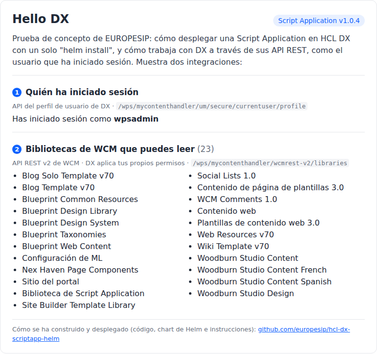

# Script Applications para HCL DX, desplegadas con Helm

[English](index.md) · **Español**

**Despliega una Script Application de HCL DX con `helm install`, como el resto de tu Kubernetes.** Una Script
Application es HTML, JavaScript y CSS guardados en el Web Content Manager (WCM) de DX: es la forma de construir
aplicaciones propias en **HCL DX Compose**. HCL las despliega con la herramienta de línea de comandos DXClient; este
repositorio envuelve ese paso en un chart de Helm, para que una Script Application tenga versión, chart y
`helm upgrade`, y pueda ir junto a los servicios de backend con los que habla. Es un ejemplo, no un producto, y no es
software de HCL. Probado en HCL DX Compose CF239 (DXClient `v95_CF239_20261103-1404`).



> Esta página es el resumen para el portal del desarrollador. La guía completa (cada paso, los valores, varias apps en
> una release, lo que hemos aprendido en DX Compose CF239, el desarrollo local) es el
> [README en GitHub](https://github.com/europesip/hcl-dx-scriptapp-helm/blob/main/README.es.md).

## Qué contiene

| Carpeta | Qué es |
|---|---|
| [app/](https://github.com/europesip/hcl-dx-scriptapp-helm/tree/main/app) | **Hello DX**, una pequeña Script Application en React (Vite, TypeScript), creada a partir de la plantilla `create-dx-script-app` de HCL. Muestra quién es el usuario y qué bibliotecas de WCM puede leer, llamando a DX **como ese usuario** |
| [app/Dockerfile](https://github.com/europesip/hcl-dx-scriptapp-helm/blob/main/app/Dockerfile) | La **imagen del bundle**: una imagen mínima que solo lleva la aplicación compilada |
| [chart/hcl-dx-scriptapp](https://github.com/europesip/hcl-dx-scriptapp-helm/tree/main/chart/hcl-dx-scriptapp) | El **chart de Helm**: un Job que sube la aplicación a DX con DXClient |

## Cómo funciona

```
helm upgrade --install hello-dx oci://ghcr.io/europesip/charts/hcl-dx-scriptapp ...
   │
   └─ Job (hook de Helm, tras cada install y upgrade)
        ├─ initContainer  imagen del bundle ─► copia la app compilada (index.html, assets/) a un volumen
        └─ container      DXClient de HCL  ─► espera a DX y hace
                                              dxclient deploy-scriptapplication push
                                              ─► WCM: Script Application Library/Script Applications/<nombre>
```

- **Primera instalación:** el push crea la Script Application en WCM. La añades a una página una vez.
- **Cada upgrade:** el push actualiza **el mismo** elemento de WCM (mismo ID de contenido), así que todas las páginas
  que la usan muestran la versión nueva. Sin reiniciar DX.
- **Por qué una imagen** y no un ConfigMap: un ConfigMap está limitado a 1 MiB, igual que el Secret donde Helm guarda
  cada release. Una imagen no tiene límite práctico, se versiona por su etiqueta y viene del mismo registro que todo lo
  demás.
- **Varias Script Applications en una release** (chart 0.2.0): `apps` sube varias apps de una sola imagen bundle y
  `afterPush` ejecuta después un script tuyo (por ejemplo, para crear las páginas). [ÓRBITA](https://github.com/europesip/orbita)
  usa así el chart, como subchart.

## Requisitos

| | |
|---|---|
| **Herramientas** | `kubectl` y `helm` (3.8+ o 4) contra el clúster donde corre DX |
| **Un usuario de DX** | Con acceso de Editor a la *Script Application Library* (fuera de un laboratorio, un usuario técnico, no `wpsadmin`); la CA del certificado de DX solo si es autofirmado o de una CA privada |
| **Licencia de DXClient** | DXClient es software de HCL con su propia licencia: léela y acéptala con `dxclient.acceptLicense=true`; si no, el chart no se instala |
| **Registros** | Sin login: el chart y la imagen del bundle son públicos en ghcr.io, y DXClient está en el repositorio público `dx-public` del Harbor de HCL |

## Instalación, en resumen

```bash
helm upgrade --install hello-dx oci://ghcr.io/europesip/charts/hcl-dx-scriptapp --version 0.1.4 \
  -n dx-shared \
  --set dx.host=dx.example.com \
  --set dx.credentialsSecret=scriptapp-dx \
  --set dx.caSecret=scriptapp-dx-ca \
  --set dxclient.acceptLicense=true
```

Después, comprueba el push (`kubectl -n dx-shared logs job/hello-dx-hcl-dx-scriptapp-push`) y añade **Hello DX** a una
página, una vez. `helm uninstall` quita el chart, **no la app de WCM**. Paso a paso, con los Secrets, las
actualizaciones y la desinstalación: [Instalarlo en tu clúster](https://github.com/europesip/hcl-dx-scriptapp-helm/blob/main/README.es.md#instalarlo-en-tu-clúster).
Todos los valores: [values.yaml](https://github.com/europesip/hcl-dx-scriptapp-helm/blob/main/chart/hcl-dx-scriptapp/values.yaml). El chart es genérico: para usarlo
con tu propia Script Application, mira
[Usarlo para tu propia Script Application](https://github.com/europesip/hcl-dx-scriptapp-helm/blob/main/README.es.md#usarlo-para-tu-propia-script-application).

## Más

| | |
|---|---|
| Código y versiones | [GitHub](https://github.com/europesip/hcl-dx-scriptapp-helm) · [Etiquetas](https://github.com/europesip/hcl-dx-scriptapp-helm/tags) |
| Relacionados | [Operador de Script Applications para HCL DX](https://github.com/europesip/hcl-dx-scriptapp-operator) · [ÓRBITA](https://github.com/europesip/orbita) · [Labs de HCL DX Compose](https://github.com/europesip/hcl-dx-compose-labs) |

Licencia: [Apache License 2.0](https://github.com/europesip/hcl-dx-scriptapp-helm/blob/main/LICENSE) ([NOTICE](https://github.com/europesip/hcl-dx-scriptapp-helm/blob/main/NOTICE)). La app parte de la plantilla
`create-dx-script-app` de HCL (Apache-2.0, HCL America Inc.). DXClient es software de HCL con su propia licencia, que
se usa desde la imagen pública de HCL y no se redistribuye aquí. HCL, Digital Experience y otros nombres de producto son
marcas de sus respectivos propietarios.
