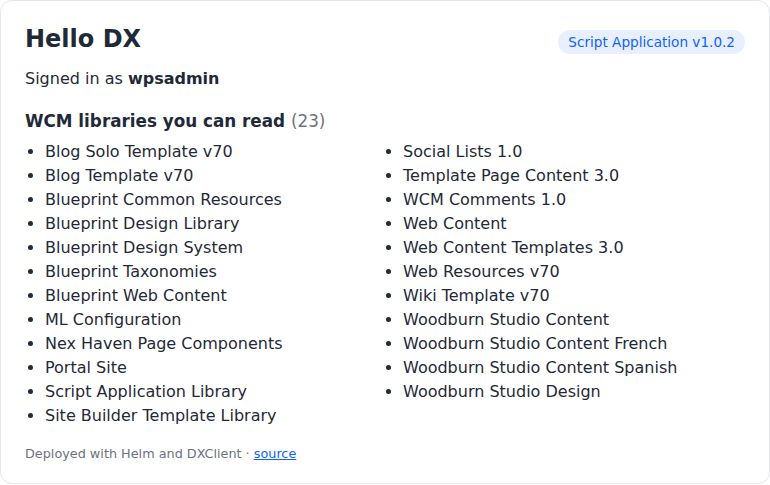

# Script Applications for HCL DX, deployed with Helm

**English** · [Español](index.es.md)

**Deploy an HCL DX Script Application with `helm install`, like the rest of your Kubernetes stack.** A Script
Application is HTML, JavaScript and CSS stored in DX's Web Content Manager (WCM): it is the way to build custom
applications on **HCL DX Compose**. HCL deploys them with the DXClient command line tool; this repository wraps that
step in a Helm chart, so a Script Application gets a version, a chart and a `helm upgrade`, and can travel with the
backend services it talks to. It is an example, not a product, and it is not HCL software. Tested on HCL DX Compose
CF239 (DXClient `v95_CF239_20261103-1404`).



> This page is the summary for the developer portal. The full guide (every step, the values, several apps in one
> release, what we learned on DX Compose CF239, local development) is the
> [README on GitHub](https://github.com/europesip/hcl-dx-scriptapp-helm#readme).

## What it contains

| Folder | What it is |
|---|---|
| [app/](https://github.com/europesip/hcl-dx-scriptapp-helm/tree/main/app) | **Hello DX**, a small React Script Application (Vite, TypeScript), made from HCL's `create-dx-script-app` template. It shows who the user is and which WCM libraries they can read, calling DX **as that user** |
| [app/Dockerfile](https://github.com/europesip/hcl-dx-scriptapp-helm/blob/main/app/Dockerfile) | The **bundle image**: a tiny image that only carries the built app |
| [chart/hcl-dx-scriptapp](https://github.com/europesip/hcl-dx-scriptapp-helm/tree/main/chart/hcl-dx-scriptapp) | The **Helm chart**: a Job that pushes the app to DX with DXClient |

## How it works

```
helm upgrade --install hello-dx oci://ghcr.io/europesip/charts/hcl-dx-scriptapp ...
   │
   └─ Job (Helm hook, after every install and upgrade)
        ├─ initContainer  bundle image ─► copies the built app (index.html, assets/) to a volume
        └─ container      HCL DXClient ─► waits for DX, then
                                          dxclient deploy-scriptapplication push
                                          ─► WCM: Script Application Library/Script Applications/<name>
```

- **First install:** the push creates the Script Application in WCM. You add it to a page once.
- **Every upgrade:** the push updates **the same** WCM item (same content ID), so every page that uses it shows the
  new version. No DX restart.
- **Why a bundle image** and not a ConfigMap: a ConfigMap is limited to 1 MiB, and so is the Secret where Helm stores
  each release. An image has no practical size limit, is versioned by its tag, and comes from the same registry as
  everything else.
- **Several Script Applications in one release** (chart 0.2.0): `apps` pushes several apps from one bundle image and
  `afterPush` runs a script of yours afterwards (for example, to create the pages). [ÓRBITA](https://github.com/europesip/orbita)
  uses the chart this way, as a subchart.

## Requirements

| | |
|---|---|
| **Tools** | `kubectl` and `helm` (3.8+ or 4) against the cluster where DX runs |
| **A DX user** | With Editor access to the *Script Application Library* (a technical user, not `wpsadmin`, outside a lab); the CA of the DX certificate only if it is self-signed or from a private CA |
| **DXClient licence** | DXClient is HCL software under its own licence: read it and accept it with `dxclient.acceptLicense=true`, or the chart refuses to install |
| **Registries** | No login: the chart and the bundle image are public on ghcr.io, and DXClient is in the public `dx-public` repository of HCL Harbor |

## Install, in short

```bash
helm upgrade --install hello-dx oci://ghcr.io/europesip/charts/hcl-dx-scriptapp --version 0.1.4 \
  -n dx-shared \
  --set dx.host=dx.example.com \
  --set dx.credentialsSecret=scriptapp-dx \
  --set dx.caSecret=scriptapp-dx-ca \
  --set dxclient.acceptLicense=true
```

Then check the push (`kubectl -n dx-shared logs job/hello-dx-hcl-dx-scriptapp-push`) and add **Hello DX** to a page,
once. `helm uninstall` removes the chart, **not the app in WCM**. Step by step, with the Secrets, updates and
uninstall: [Install it on your cluster](https://github.com/europesip/hcl-dx-scriptapp-helm#install-it-on-your-cluster). Every value:
[values.yaml](https://github.com/europesip/hcl-dx-scriptapp-helm/blob/main/chart/hcl-dx-scriptapp/values.yaml). The chart is generic: to use it for your own Script
Application, see [Use it for your own Script Application](https://github.com/europesip/hcl-dx-scriptapp-helm#use-it-for-your-own-script-application).

## More

| | |
|---|---|
| Source and versions | [GitHub](https://github.com/europesip/hcl-dx-scriptapp-helm) · [Tags](https://github.com/europesip/hcl-dx-scriptapp-helm/tags) |
| Related | [HCL DX Script Application operator](https://github.com/europesip/hcl-dx-scriptapp-operator) · [ÓRBITA](https://github.com/europesip/orbita) · [HCL DX Compose labs](https://github.com/europesip/hcl-dx-compose-labs) |

Licence: [Apache License 2.0](https://github.com/europesip/hcl-dx-scriptapp-helm/blob/main/LICENSE) ([NOTICE](https://github.com/europesip/hcl-dx-scriptapp-helm/blob/main/NOTICE)). The app starts from HCL's
`create-dx-script-app` template (Apache-2.0, HCL America Inc.). DXClient is HCL software under its own licence, used
from HCL's public image and not redistributed here. HCL, Digital Experience and other product names are trademarks of
their respective owners.
